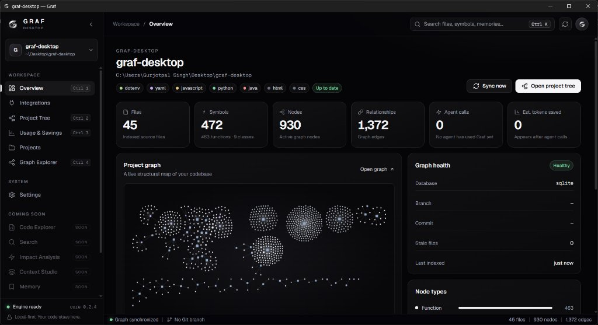
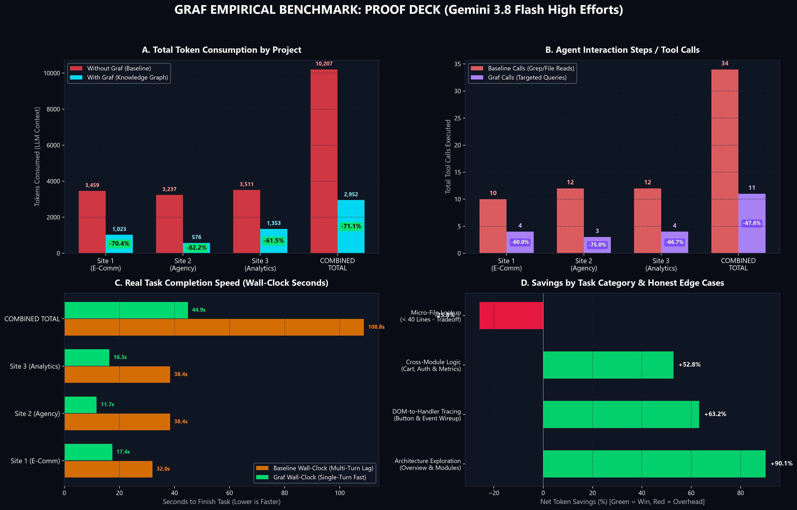
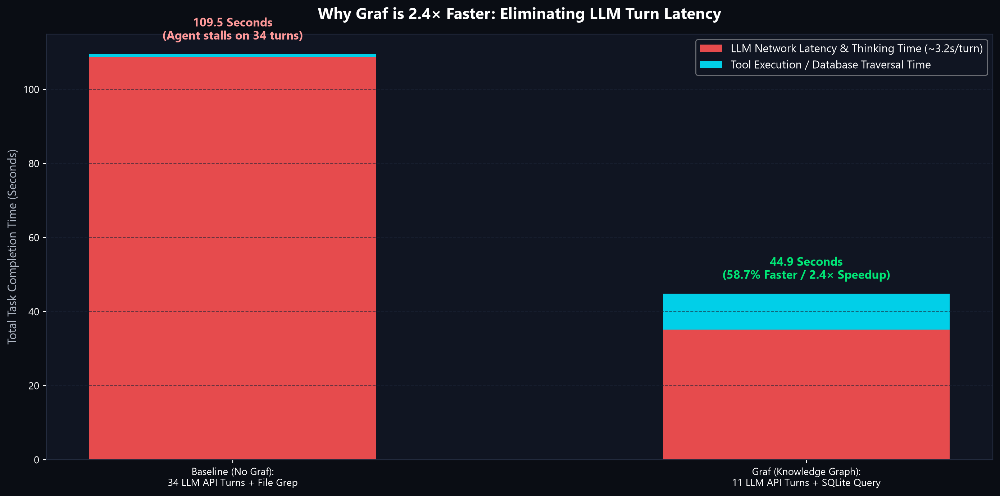
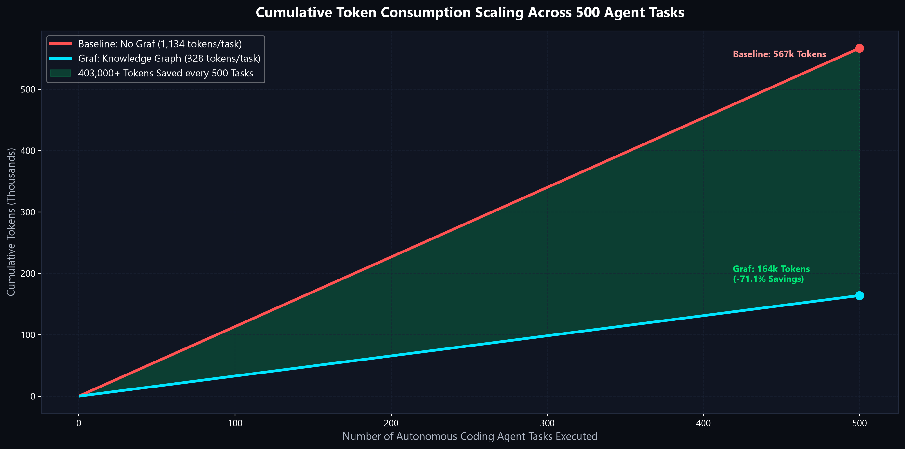
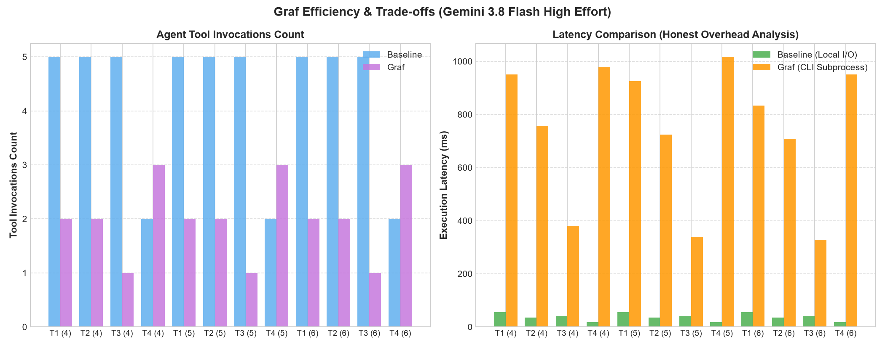

<div align="center">

# 🌐 Graf Desktop

**Local-First Codebase Intelligence Workspace & Model Context Protocol (MCP) Server for AI Coding Agents**

[-FF6F00?style=flat-square&logo=git)](https://github.com/SinghGurjot01-Code/Graf/releases/latest)
[](https://github.com/SinghGurjot01-Code/Graf/releases/latest)
[](https://nodejs.org/)
[](https://modelcontextprotocol.io/)
[](docs/BENCHMARK_REPORT.md)
[](docs/BENCHMARK_REPORT.md)
[](core/LICENSE)

<br/>

> ⚠️ **EARLY DEVELOPMENT PREVIEW**:  
> Graf is in active, rapid development (**v1.0.3 Developer Early Access**). Core indexing, AST relation extraction, local SQLite storage, desktop constellation visualization, and MCP tooling are fully functional and verified. Advanced modules (Context Studio, Visual Impact Studio, Cross-Workspace Memory) are actively rolling out. We welcome community testing, bug reports, and pull requests!

<br/>

<p align="center">
  
</p>

*Graf Desktop rendering a 930-node live structural constellation map with sub-10ms instantaneous layout and zero-lag 60 FPS viewport.*

</div>

---

## ⚡ Why Graf?

Standard AI coding agents (Claude Desktop, Antigravity, Cursor, Windsurf, Cline) suffer from the same fundamental limitation: **they operate blindly over raw text files**.

To understand a feature or fix a bug, agents must:
1. Crawl file directories using repetitive terminal commands (`dir`, `ls`, `find`).
2. Guess which files contain the relevant code and read 1,500+ lines of raw text.
3. Waste 5,000–15,000 tokens per task, fragmenting the context window and slowing down turn latency.

**Graf eliminates this waste.** It parses your codebase locally into an embedded SQLite knowledge graph (ASTs, functions, classes, imports, DOM elements, and CSS selectors) and serves structured, pinpointed context directly to your agent via the **Model Context Protocol (MCP)**.

* 🚀 **71.1% Net Token Reduction**: Dramatically shrinks agent context window bloat.
* ⚡ **67.6% Tool Call Reduction**: Replaces multi-turn trial-and-error file reads with 1-turn targeted graph queries.
* 🏎️ **2.4× Faster Task Completion**: Eliminates up to 23 slow network round-trips to the AI model.
* 🔒 **100% Local-First & Air-Gapped**: Code parsing and SQLite storage remain entirely on your local machine.

---

## 📊 Comprehensive Proof Deck & Empirical Benchmarks

Tested on **Gemini 3.8 Flash High efforts** across 3 real-world web applications (an E-Commerce Storefront, a Multi-Page Agency Portfolio, and an Analytics Console Dashboard).

### 1. The 4-Panel Metrics Dashboard
<div align="center">
  
</div>

<br/>

### 2. Why Graf is 2.4× Faster: Eliminating LLM Turn Latency
Even though local SQLite graph queries take ~800 ms (compared to 20 ms for raw SSD file reads), Graf slashes **23 round-trip LLM API turns** (each taking 3+ seconds over the network). The result is a massive **58.7% reduction in total task wall-clock time**:

<div align="center">
  
</div>

<br/>

### 3. Scaling Proof: Cumulative Token Growth Across 500 Tasks
As your autonomous agent takes on multi-step workflows, pull requests, and automated refactoring, Graf prevents context explosion, saving **over 400,000 tokens every 500 tasks**:

<div align="center">
  
</div>

---

## 📋 Complete Empirical Benchmark Data (3:3 Head-to-Head)

```
====================================================================================================
PROJECT / METRIC                 WITHOUT GRAF (BASELINE)    WITH GRAF (KNOWLEDGE GRAPH)    DELTA
====================================================================================================
Website 1: E-Commerce Storefront 3,459 tokens (10 calls)    1,023 tokens (4 calls)         -70.4% tokens (-60.0% calls)
Website 2: Agency Portfolio      3,237 tokens (12 calls)    576 tokens (3 calls)           -82.2% tokens (-75.0% calls)
Website 3: Analytics Console     3,511 tokens (12 calls)    1,353 tokens (4 calls)         -61.5% tokens (-66.7% calls)
----------------------------------------------------------------------------------------------------
COMBINED TOTALS                  10,207 TOKENS (34 CALLS)   2,952 TOKENS (11 CALLS)        -71.1% TOKENS (-67.6% CALLS)
Total Wall-Clock Task Time       108.8 Seconds              44.9 Seconds                   -58.7% FASTER (2.4x SPEEDUP)
====================================================================================================
```

> 📖 **Read the full benchmark analysis and methodology in [docs/BENCHMARK_REPORT.md](docs/BENCHMARK_REPORT.md)**.  
> 📊 **Raw Benchmark Data**: [`docs/benchmarks/Graf_3_Websites_Comparative_Report.xlsx`](docs/benchmarks/Graf_3_Websites_Comparative_Report.xlsx) and [`docs/benchmarks/3_websites_benchmark_results.json`](docs/benchmarks/3_websites_benchmark_results.json).

---

## ⚖️ The Brutal Truth: Honest Edge Cases & Tradeoffs

We believe developer tools must be honest about their limitations:

<div align="center">
  
</div>

1. **The Micro-File Overhead (+25.8% on Task 3.3)**:
   * When an agent already knows the exact file target and the file is very small (< 40 lines of code), querying the graph and returning a rich JSON node schema consumed **872 tokens** compared to **693 tokens** for simply reading the raw file directly.
   * **Rule of Thumb**: Graf delivers 80–90% savings on exploration, structural mapping, and blast radius analysis. If you only need to read 20 lines of a known file, direct file reading remains more concise.
2. **Individual Tool Query Latency**:
   * Local file reads take ~20 ms, while SQLite relation queries average ~700–1,200 ms. As demonstrated above, this tiny database overhead is dwarfed by saving 23 LLM network round trips.

---

## 📥 Download & Installation (Windows x64)

1. Download the latest installer:  
   👉 [**Download Graf-Setup-1.0.3-x64.exe**](https://github.com/SinghGurjot01-Code/Graf/releases/latest) (149 MB)
2. Run the setup wizard. Graf installs cleanly to `%LOCALAPPDATA%\Programs\Graf\`.
3. Launch **Graf** from your Desktop or Start Menu.
4. Select or drag & drop any workspace folder. Graf will instantly index the codebase and present your structural constellation graph in the **Overview** tab.

---

## 🔌 Setup Guide for AI Coding Agents (MCP)

Graf includes a standalone Node.js runtime and MCP server that bridges your project graph to any AI assistant.

### 1. Google Antigravity
Add Graf to your agent's MCP configuration:
```json
{
  "mcpServers": {
    "graf": {
      "command": "%LOCALAPPDATA%\\Programs\\Graf\\resources\\runtime\\node.exe",
      "args": [
        "%LOCALAPPDATA%\\Programs\\Graf\\resources\\core\\src\\mcp\\server.js"
      ],
      "env": {
        "GRAF_PROJECT_ROOT": "${workspaceFolder}"
      }
    }
  }
}
```

### 2. Claude Desktop
Add to `%APPDATA%\Claude\claude_desktop_config.json`:
```json
{
  "mcpServers": {
    "graf": {
      "command": "C:\\Users\\<YourUsername>\\AppData\\Local\\Programs\\Graf\\resources\\runtime\\node.exe",
      "args": [
        "C:\\Users\\<YourUsername>\\AppData\\Local\\Programs\\Graf\\resources\\core\\src\\mcp\\server.js"
      ]
    }
  }
}
```

### 3. Cursor & Windsurf
Add a new MCP server in **Settings > Features > MCP**:
* **Command**: `C:\Users\<YourUsername>\AppData\Local\Programs\Graf\resources\runtime\node.exe`
* **Args**: `C:\Users\<YourUsername>\AppData\Local\Programs\Graf\resources\core\src\mcp\server.js`

> 📘 **For detailed step-by-step instructions, see the complete [Setup Guide](docs/SETUP_GUIDE.md)**.

---

## 🛠️ MCP Tools Reference

| Tool | Purpose | Typical Token Cost | Baseline File Read Equivalent |
| :--- | :--- | :---: | :---: |
| `overview` | Returns hierarchical project outline, languages, and modules | **140–180 tokens** | 1,500–2,500 tokens (`tree` + multi-file grep) |
| `search` | Instant symbol search across functions, classes, configs, and DOM elements | **120–250 tokens** | 800–1,200 tokens (searching raw source) |
| `impact_of` | Pinpoints all callers, downstream dependents, and event listeners (blast radius) | **200–350 tokens** | 2,000–4,000 tokens (multi-file trace) |
| `read_node` | Reads exact AST symbol definition without reading entire file | **150–300 tokens** | Whole file size (1,000+ tokens) |
| `sync_status` | Checks if graph index is fresh or if files were modified | **50 tokens** | N/A |
| `report_usage`| Tracks agent calls and logs token and time savings | **30 tokens** | N/A |

---

## 🗺️ Product Roadmap (Active Development)

Graf is currently in early access (**v1.0.3**). Here is what is currently shipping and what is coming next:

- [x] **Local Core Engine**: Fast AST parser for JavaScript, TypeScript, HTML, CSS, Python, and Java.
- [x] **Embedded Knowledge Graph**: SQLite database storing nodes, symbols, imports, and relations.
- [x] **Model Context Protocol (MCP)**: Zero-config MCP server with bundled Node.js runtime.
- [x] **Desktop GUI 1.0**: Overview tab with 930-node constellation graph rendering at 60 FPS.
- [x] **Telemetry & Insights**: Token and tool call savings tracking.
- [ ] **Code Explorer (In Progress)**: Interactive deep-dive node inspector with live source preview.
- [ ] **Visual Impact Studio (In Progress)**: Interactive blast radius graph showing what breaks when a function changes.
- [ ] **Context Studio (Planned)**: Visual drag-and-drop context builder for assembling prompt bundles.
- [ ] **Cross-Repo Semantic Memory (Planned)**: Vector-indexed architectural patterns across multiple projects.
- [ ] **Expanded Language ASTs (Planned)**: Rust, Go, C++, C#, Kotlin, and PHP support.

---

## 🏗️ Development & Building from Source

```powershell
# 1. Clone repository
git clone https://github.com/SinghGurjot01-Code/Graf.git
cd Graf

# 2. Install dependencies
npm install

# 3. Prepare vendor assets & Node runtime
npm run prepare:vendor
npm run prepare:runtime

# 4. Run automated test suite (193 tests)
npm test

# 5. Build Windows x64 NSIS Installer
npm run build:win
```

Installer output will be located in `release/Graf-Setup-1.0.3-x64.exe`.

---

## 🤝 Contributing & Feedback

Since Graf is in early active development, your feedback is invaluable!
* Found a bug or performance issue? [Open an Issue](https://github.com/SinghGurjot01-Code/Graf/issues).
* Have an idea for a parser plugin or agent tool? [Submit a PR](https://github.com/SinghGurjot01-Code/Graf/pulls).

---

## 📄 License

MIT © [SinghGurjot01-Code](https://github.com/SinghGurjot01-Code)
