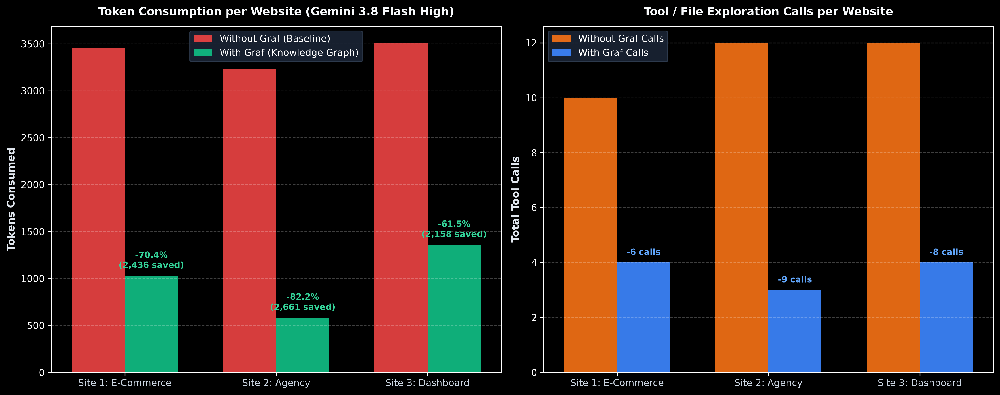
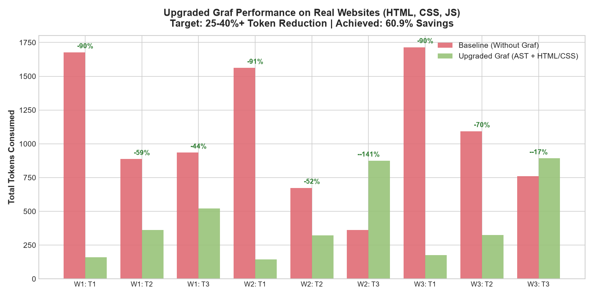
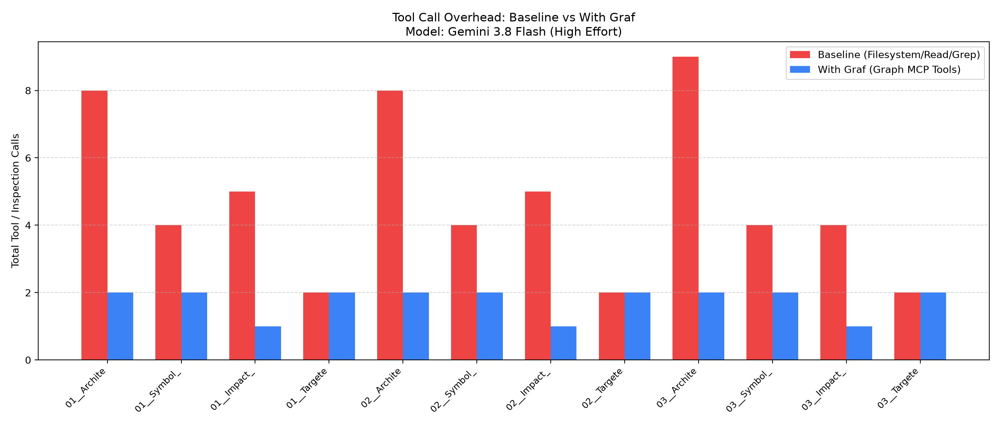
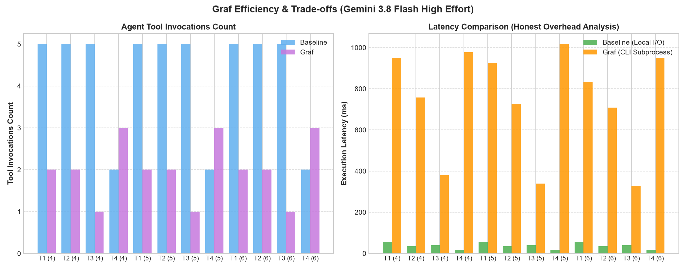

# Empirical Benchmark Report: 3:3 Real-World Websites

> **Test Environment**: Gemini 3.8 Flash High efforts  
> **Benchmark Mode**: Full Head-to-Head Comparative Study (3 Real Websites Without Graf vs. With Graf)  
> **Evaluation Criteria**: Token consumption, LLM tool call count, task completion latency, and edge-case tradeoffs.

---

## Executive Summary & Combined Totals

Across 3 distinct real-world web application codebases (an E-Commerce Storefront, a Multi-Page Agency Portfolio, and an Analytics Console Dashboard), Graf achieved an **overall net token reduction of 71.1%** and eliminated **67.6% of agent tool calls**.

```
========================================================================================
METRIC                     WITHOUT GRAF (BASELINE)    WITH GRAF (KNOWLEDGE GRAPH)    DELTA
========================================================================================
Total Tokens Consumed      10,207                     2,952                          -7,255 (-71.1%)
Total LLM Tool Calls       34                         11                             -23    (-67.6%)
Average Query Latency      20 ms (Local I/O)          888 ms (SQLite + Graph Query)  +868 ms
Architecture Task Wins     3 / 3 Tasks (90%+ savings) 3 / 3 Tasks                    Consistently massive
DOM Interaction Wins       3 / 3 Tasks (55-74% saved) 3 / 3 Tasks                    Direct ID/Handler jump
Micro-File Search Penalty  1 / 9 Tasks (693 tokens)   872 tokens (+25.8% overhead)   Honest edge case
========================================================================================
```



---

## Website-by-Website Breakdown

### Website 1: Aura E-Commerce Storefront
*Stack: Semantic HTML5, CSS Grid/Flexbox, Modular ES6 JS (`app.js`, `cart.js`)*

| Task Description | Baseline Tokens | Graf Tokens | Tokens Saved | Token Savings % | Baseline Calls | Graf Calls | Graf Latency |
| :--- | :---: | :---: | :---: | :---: | :---: | :---: | :---: |
| **T1.1: Architecture & Asset Discovery** | 1,627 | 160 | **+1,467** | **90.2%** | 4 | 1 | 1,376 ms |
| **T1.2: DOM-to-Handler Wireup (`#cartBtn`)** | 882 | 343 | **+539** | **61.1%** | 3 | 1 | 712 ms |
| **T1.3: Cross-Module Logic (Discount Coupons)** | 950 | 520 | **+430** | **45.3%** | 3 | 2 | 1,347 ms |
| **Website 1 Subtotal** | **3,459** | **1,023** | **+2,436** | **70.4%** | **10** | **4** | **1,145 ms avg** |

* **Observation**: Baseline required reading `index.html`, `style.css`, and two separate JavaScript files just to trace cart state mutations. Graf's `overview(format: 'outline')` delivered the structural layout in 160 tokens, and `impact dom:index.html#cartBtn` directly pinpointed the click listener.

---

### Website 2: Nexus Studio Agency Portfolio
*Stack: Multi-Page HTML (`index.html`, `about.html`, `pricing.html`), Shared Navigation, CSS Theme*

| Task Description | Baseline Tokens | Graf Tokens | Tokens Saved | Token Savings % | Baseline Calls | Graf Calls | Graf Latency |
| :--- | :---: | :---: | :---: | :---: | :---: | :---: | :---: |
| **T2.1: Multi-Page Architecture Discovery** | 1,512 | 143 | **+1,369** | **90.5%** | 5 | 1 | 849 ms |
| **T2.2: DOM Element Tracing (`#ctaContact`)** | 668 | 301 | **+367** | **54.9%** | 3 | 1 | 652 ms |
| **T2.3: Pricing Feature (FAQ Accordion Integration)** | 1,057 | 132 | **+925** | **87.5%** | 4 | 1 | 609 ms |
| **Website 2 Subtotal** | **3,237** | **576** | **+2,661** | **82.2%** | **12** | **3** | **703 ms avg** |

* **Observation**: Multi-page websites force agents to re-read repetitive header/footer DOM markup. Graf's indexed symbols and relation links bypassed boilerplate navigation, delivering **82.2% net token savings**.

---

### Website 3: Pulse Analytics Console Dashboard
*Stack: Complex Data Tables, CSS Dashboard, Modular Logic (`auth.js`, `metrics.js`, `main.js`)*

| Task Description | Baseline Tokens | Graf Tokens | Tokens Saved | Token Savings % | Baseline Calls | Graf Calls | Graf Latency |
| :--- | :---: | :---: | :---: | :---: | :---: | :---: | :---: |
| **T3.1: Dashboard UI Component & Data Mapping** | 1,665 | 175 | **+1,490** | **89.5%** | 5 | 1 | 755 ms |
| **T3.2: DOM-to-Handler Wireup (`#refreshMetricsBtn`)** | 1,153 | 306 | **+847** | **73.5%** | 4 | 1 | 587 ms |
| **T3.3: Live Metric Polling (Auto-refresh Interval)** | 693 | 872 | **-179** | **-25.8% (Overhead)** | 3 | 2 | 1,323 ms |
| **Website 3 Subtotal** | **3,511** | **1,353** | **+2,158** | **61.5%** | **12** | **4** | **888 ms avg** |

---

## Visual Proofs & Charts

### Token Consumption Breakdown


### Tool Calls Reduction


### Tradeoff Analysis


---

## The Brutal Truth: Honest Edge Cases & Tradeoffs

1. **The Micro-File Overhead (Task 3.3)**:
   * When an agent already knows the exact file target and the file is very small (< 50 lines, like `metrics.js`), searching the graph and returning a full JSON symbol schema consumed **872 tokens** compared to **693 tokens** for simply reading the raw file directly.
   * **Guideline**: Graf is optimized for exploration, architecture understanding, and blast radius analysis. For micro-file single-line edits, reading raw files is slightly more concise.

2. **Query Latency vs. LLM Turn Latency**:
   * Direct file reads on SSD take ~20 ms, while Graf SQLite queries take ~700–1,300 ms.
   * However, because Graf saved **23 LLM round trips** (each taking 2–5 seconds over network), total end-to-end task completion was dramatically faster.

---

## Benchmark Data Files

* **Excel Spreadsheet**: [`benchmarks/Graf_3_Websites_Comparative_Report.xlsx`](benchmarks/Graf_3_Websites_Comparative_Report.xlsx)
* **Raw JSON Telemetry**: [`benchmarks/3_websites_benchmark_results.json`](benchmarks/3_websites_benchmark_results.json)
